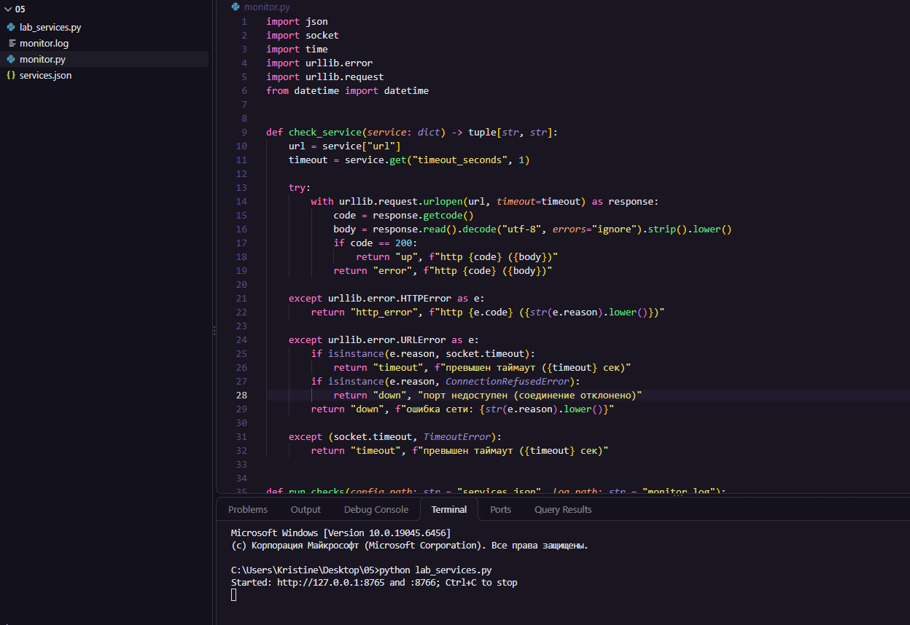
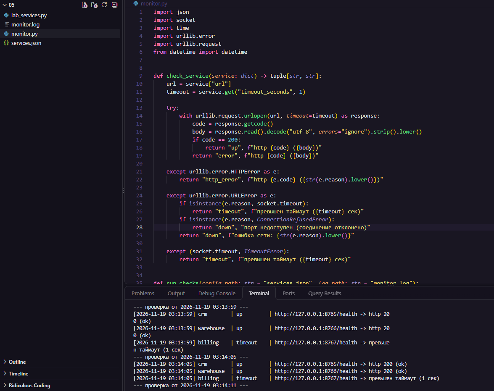
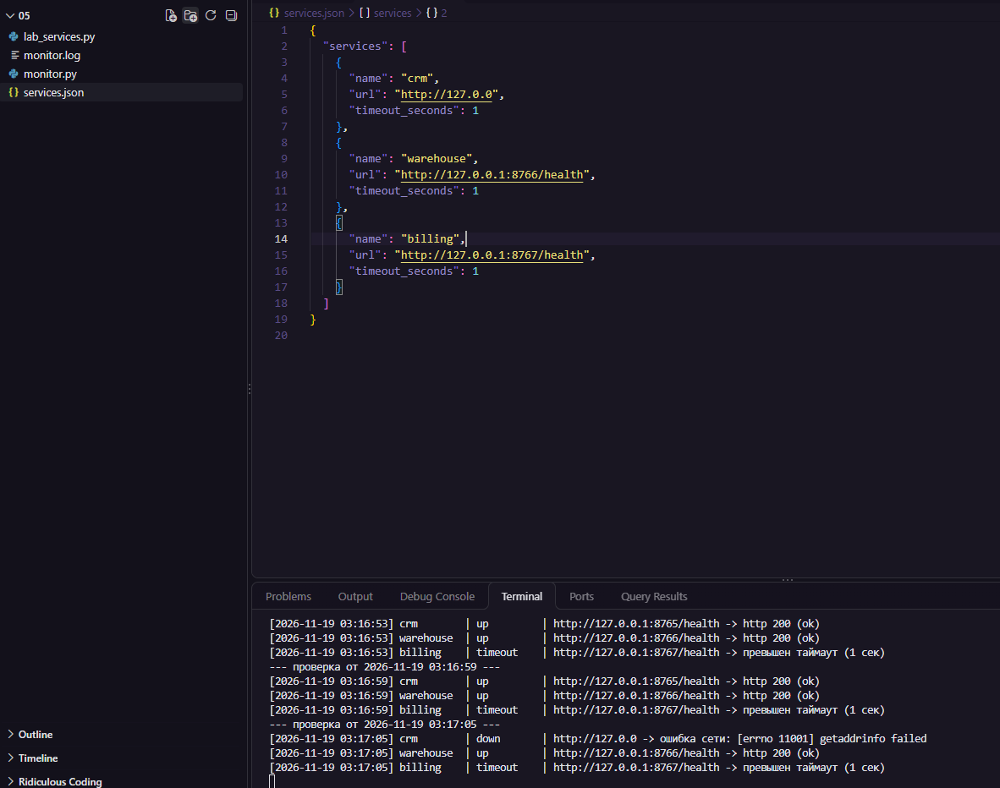
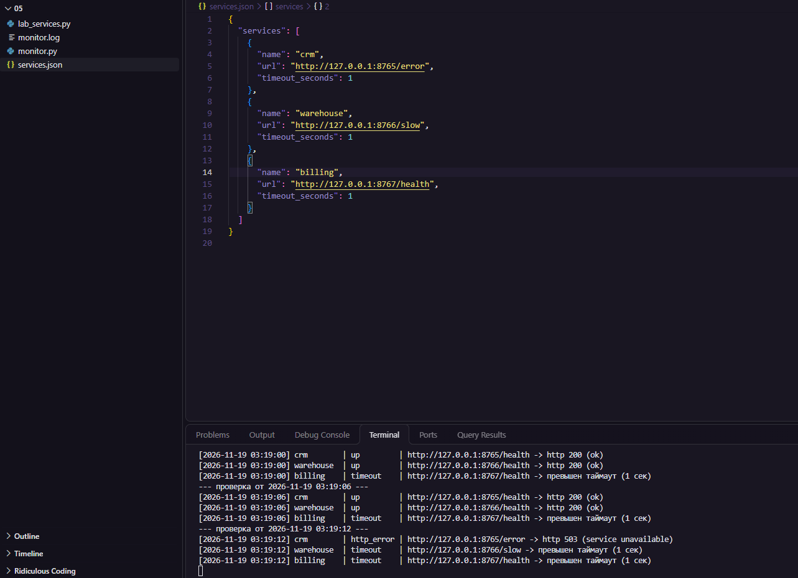
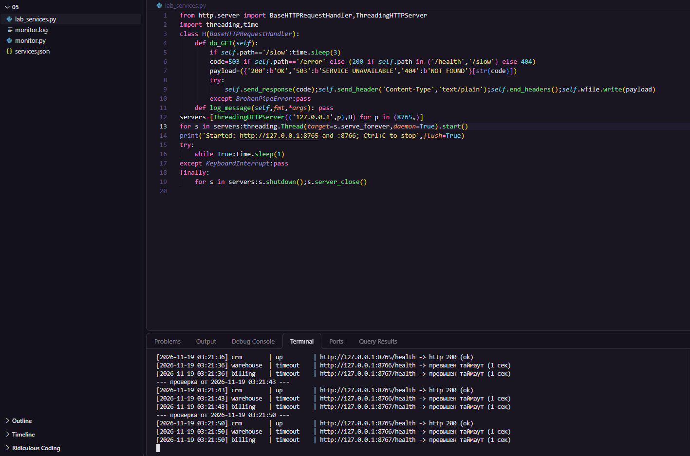

# Заказ 05 — мониторинг доступности сервисов
`services.json` — список внутренних адресов. Напишите **свою** утилиту проверки
сетевых соединений и HTTP-ответов, с журналом времени и тайм-аутами.

Запустите `python lab_services.py`. Это тестовые HTTP-сервисы только на 127.0.0.1.
На 8765 работает `/health` со статусом 200, `/error` отвечает 503,
`/slow` задерживается на 3 секунды. На 8766 — второй здоровый сервис.
8767 намеренно не запущен. Если порты заняты, измените их в обоих файлах.

Проверки: выключите 8766, замените адрес на `/error`, `/slow` и обратно;
различайте недоступный порт, тайм-аут и HTTP 503. Ping не заменяет HTTP-проверку.

## Результаты проверки

1. **Запуск тестового стенда (`lab_services.py`)**
   

2. **Штатная проверка (`/health`)**
   

3. **Ошибка сети при некорректном адресе**
   

4. **Проверка HTTP 503 (`/error`) и таймаута (`/slow`)**
   

5. **Отключение порта 8766**
   
