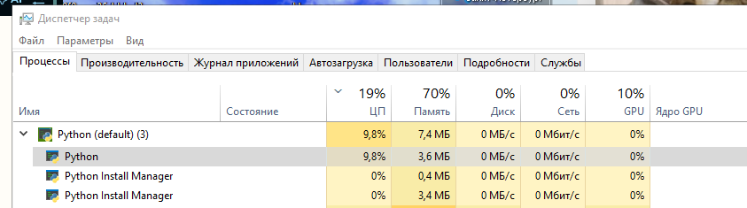
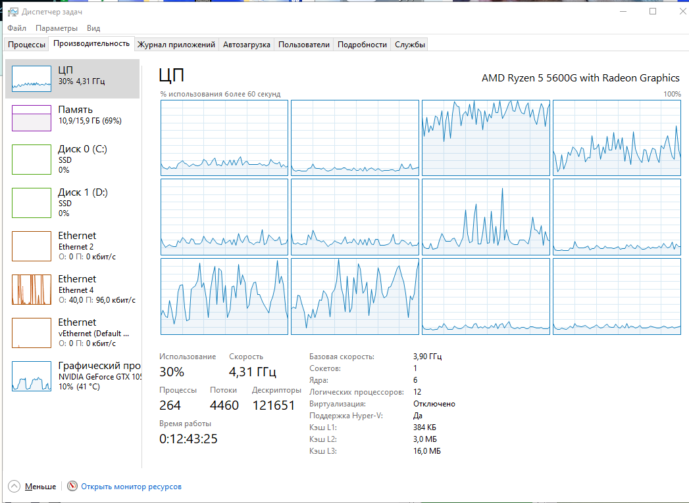
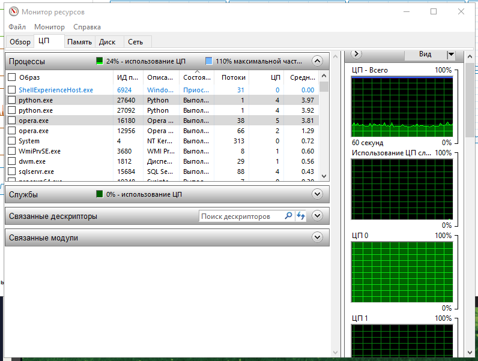
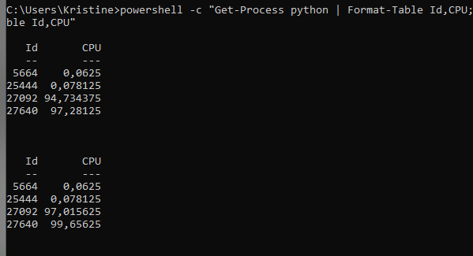

# ЛР 6. Кто загружает процессор

Система: Windows 10
Ядер (логических процессоров): 6   

## Одна нагрузка
Процент процесса в мониторе: 9.8   
Общая загрузка: 19   
На каких ядрах видна нагрузка: всех   

## Две нагрузки
Проценты обеих нагрузок и общая загрузка: 30 на 12 процессоров   
На одном ядре (в macOS — фоновый режим): 24   

## Процессорное время
Первый замер, второй замер, пауза:   
первый замер   
 5664    0,0625   
25444  0,078125   
27092 94,734375   
27640  97,28125   

второй замер    
 5664    0,0625   
25444  0,078125   
27092 97,015625   
27640  99,65625   

Загрузка по замерам: 4.66 секунд
Почему процент в мониторе не говорит о скорости работы: процент загрузки показывает только долю времени

Не получилось: ___

## Снимки экрана

Сохраните снимок поверх заглушки в папке `screenshots/` с тем же именем — ссылки ниже менять не нужно.

### 1. Одна нагрузка
Шаг 1. Видно: процесс Python в мониторе: его процент и общая загрузка.

### 2. Две нагрузки
Шаг 3. Видно: два процесса Python и загрузка ядер.

### 3. Нагрузки на одном ядре
Шаг 4. Видно: две нагрузки на одном ядре и их проценты; в macOS — два числа оборотов цикла.

### 4. Процессорное время
Шаг 5. Видно: два замера процессорного времени с паузой между ними.

