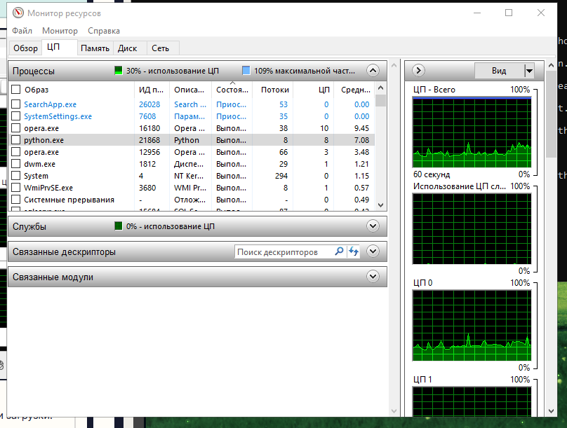
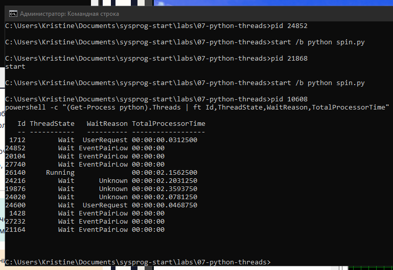
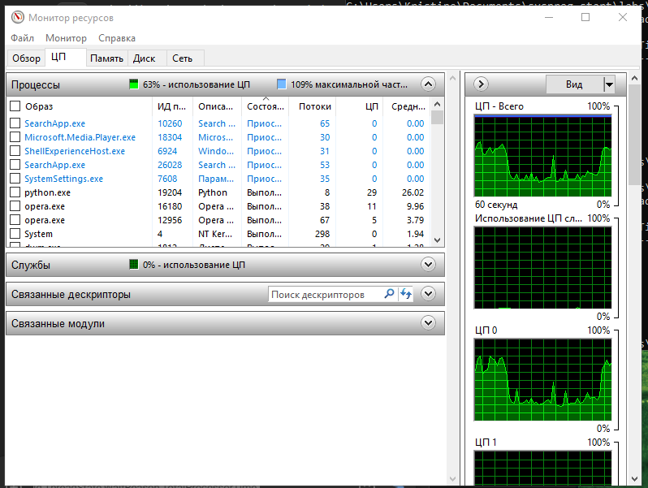
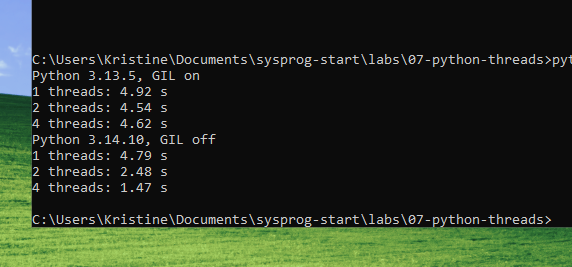

# ЛР 7. Потоки Python и GIL

Система: Windows 10
Ядер (логических процессоров): 6
Версии Python (обычный и без GIL): python3.14.exe и python3.14t.exe

## Python с GIL
Процент процесса и число потоков: 8 процентов и 8 потоков   
Сколько потоков выполняется одновременно: 30   
всего 12 работников, работает только 1   

## Python без GIL
Процент процесса и проценты потоков: 29 цп и 8 потоков   

## Время работы
С GIL, 1 / 2 / 4 потока: 4.92 s / 4.54 s / 4.62 s   
Без GIL, 1 / 2 / 4 потока: 4.79 s / 2.48 s / 1.47 s    
Без GIL с PYTHON_GIL=1: 4.69 s / 4.86 s / 4.79 s    
Ожидание, 1 и 4 потока:  2.00 s и 2.00 s   
Почему ожидающие потоки ускоряются и с GIL: во время операций ожидания поток добровольно освобождает GIL    

Не получилось: ___

## Снимки экрана

Сохраните снимок поверх заглушки в папке `screenshots/` с тем же именем — ссылки ниже менять не нужно.

### 1. Четыре потока с GIL
Шаг 1. Видно: процесс Python в мониторе: его процент и число потоков.

### 2. Потоки процесса
Шаг 2. Видно: список потоков процесса: сколько выполняется, сколько ждёт.

### 3. Четыре потока без GIL
Шаг 3. Видно: процесс python3.14t в мониторе: его процент.

### 4. Время работы
Шаг 4. Видно: вывод threads.py в Python с GIL и без.

