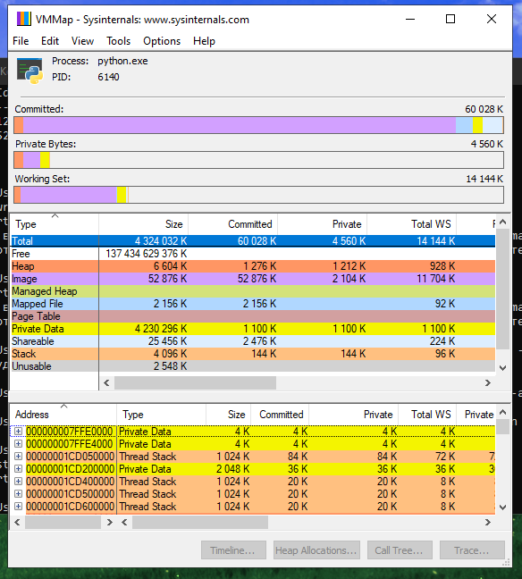
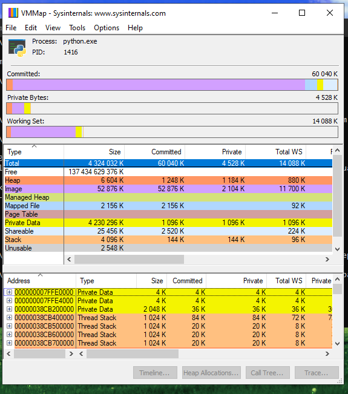
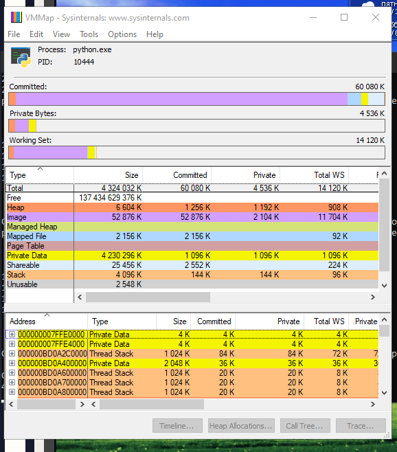
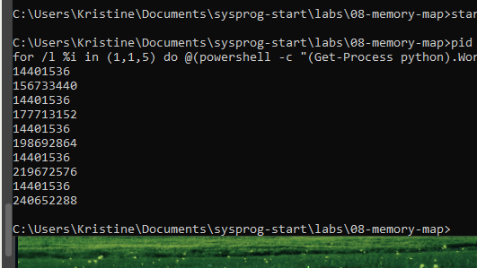

# ЛР 8. Карта памяти

Система: Windows 10   
Чем мерила (виртуальная и занятая): VMMap   

## Этапы mem.py
Старт: обещано 60к, используется 14к   
Получил 300 МБ: обещано 60к, используется 14к   
Записал в каждую страницу: обещано 60к, занято 14к   
Освободил: 8148     14364672             4988928          4422053888   
Почему занятая память выросла только на третьем этапе: из-за ленивого выделения памяти   

## Карта памяти
Из каких частей состоит память процесса: образ, куча, приватные данные, управляемая куча, стек, отображаемые, разделяемая, таблицы, свободная, неиспользуемая    

## Утечка
Пять замеров leak.py: 14401536   
156733440   
14401536   
177713152   
14401536   
На сколько росла память за 2 секунды: на 0 байт

Не получилось: ___

## Снимки экрана

Сохраните снимок поверх заглушки в папке `screenshots/` с тем же именем — ссылки ниже менять не нужно.

### 1. Карта памяти
Шаг 2. Видно: карта памяти процесса mem.py на старте и её итог.

### 2. Получено 300 МБ
Шаг 3. Видно: виртуальная память выросла на 300 МБ, занятая — нет.

### 3. Страницы заняты
Шаг 4. Видно: занятая память (в macOS — физический след) после записи в каждую страницу.

### 4. Утечка
Шаг 6. Видно: пять замеров памяти leak.py.

