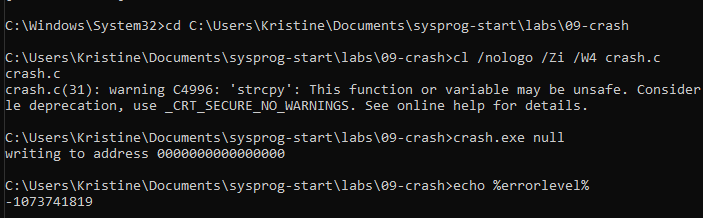
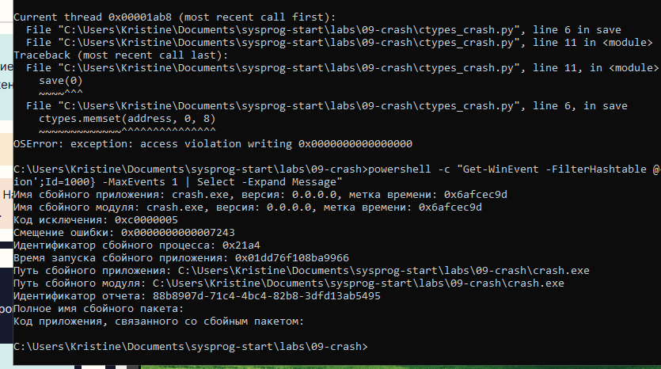
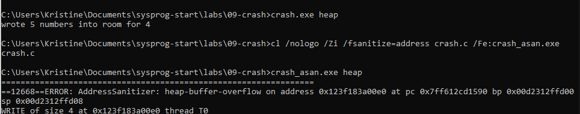
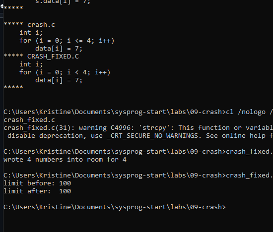

# ЛР 9. Разбор падения

Система: Windows 10   
Компилятор: Microsoft (R) C/C++ Optimizing Compiler Version 19.51.36256 for x64   

## Падение
crash null: что напечатано и код завершения: writing to address 0000000000000000 и -1073741819   
ctypes_crash.py: что напечатал Python: OSError: exception: access violation writing 0x0000000000000000   
Где система записала падение: в журнал «Приложение» с тем же кодом   

## Молчаливые ошибки
crash overflow: limit до и после, код: limit before: 100   
limit after:  7   
crash heap без проверки: wrote 5 numbers into room for 4 ERROR: AddressSanitizer   
AddressSanitizer для heap: вид ошибки и строка: name after free: agent ERROR: AddressSanitizer   
AddressSanitizer для uaf: ERROR: AddressSanitizer   

## Исправление
Что изменено и что напечатала исправленная программа: wrote 4 numbers into room for 4   
limit before: 100   
limit after:  100   

Не получилось: некоторые проверки ошибок давали не те результаты, которые показаны на примере

## Снимки экрана

Сохраните снимок поверх заглушки в папке `screenshots/` с тем же именем — ссылки ниже менять не нужно.

### 1. Падение
Шаг 1. Видно: запуск crash null и код завершения.

### 2. Падение Python
Шаг 2. Видно: вывод ctypes_crash.py и запись системы о падении.

### 3. Отчёт AddressSanitizer
Шаг 4. Видно: вывод crash heap без проверки и с AddressSanitizer (на Windows с ARM — без проверки).

### 4. Исправление
Шаг 6. Видно: разница файлов и вывод исправленной программы.

